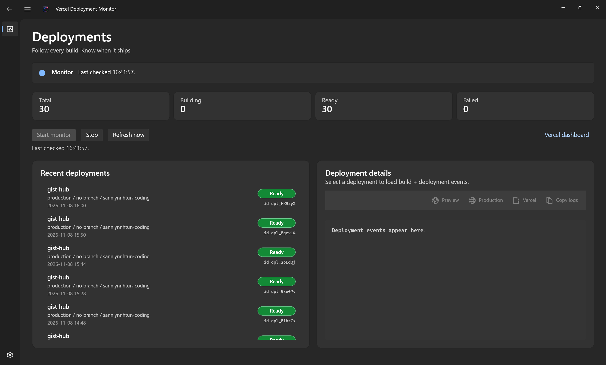
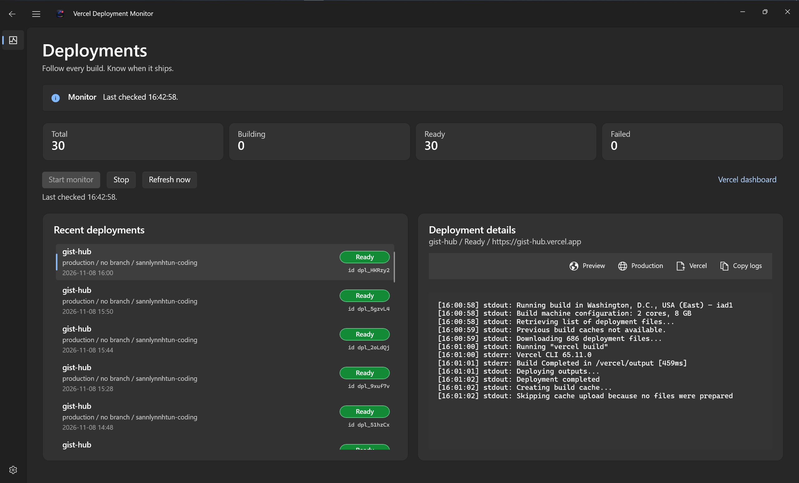
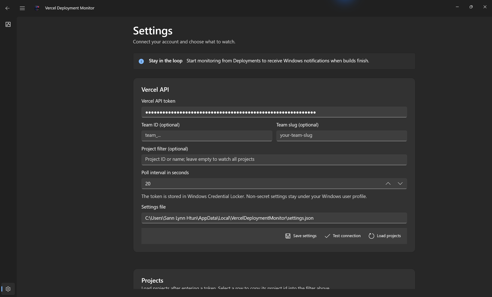
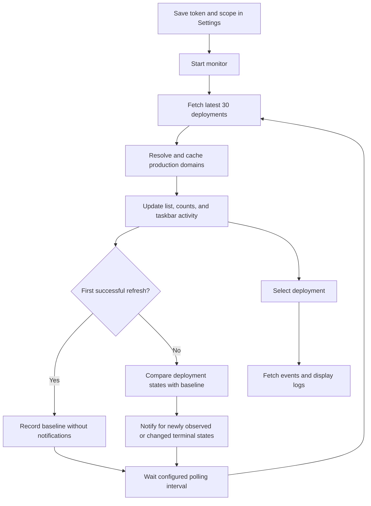

# Vercel Deployment Monitor

A Windows desktop app that keeps recent Vercel deployments, build logs, and completion notifications in one place. Built with C# and WinUI 3 on the Windows App SDK.

## Version 1.0

Version 1.0 introduces a more compact dashboard and grouped connection and monitoring settings. On smaller windows, the dashboard scrolls while keeping the deployment list and logs at usable heights; settings actions stack vertically.

Windows package version: `1.0.0.0`. Application version: `1.0.0`.

## Install on Windows x64

Download the **self-signed x64 MSIX**, public `.cer` certificate, and checksums from the [version 1.0 release](https://github.com/sannlynnhtun-coding/vercel-deployment-monitor/releases/tag/v1.0.0). Follow the [trust and installation instructions](docs/INSTALL.md) to verify the certificate, import it into Local Machine Trusted People, and install the app.

The publisher certificate is self-signed: Windows does not trust it automatically. Only import it if you trust this project's publisher. The private signing key is never distributed.

## Overview

Use the app to watch deployments across your accessible Vercel projects or focus on a single project. The dashboard shows deployment status, branch, creator, environment, and timestamps, with build events available for the selected deployment.

- **Deployment summary:** total, building, ready, and failed counts for the latest fetched deployments. Canceled deployments count as failed.
- **Monitoring:** periodic checks with a configurable interval, plus a manual refresh action.
- **Windows integration:** taskbar activity while deployments are queued, initializing, or building; local notifications when deployments finish.
- **Deployment inspection:** view and copy build logs, open the deployment preview, open its production domain, or inspect it in Vercel.
- **Account scope:** optional team ID/team slug and project ID/name filters.
- **Adaptive layout:** deployment list and details appear side by side on wide windows and stack on narrower windows. Controls use Windows theme resources.

The app observes deployments. It does not create, cancel, or redeploy them.

## Screenshots

Actual captures of the redesigned app running on Windows in dark mode.

### Wide dashboard

Deployment totals, recent deployments, and the details pane displayed side by side.



### Deployment logs

Select a deployment to inspect its build events and access preview, production, Vercel, and copy-log actions.



### Settings

Configure the Vercel connection, optional team and project filters, and polling interval. The API token remains masked.



## Requirements

- Windows. The project declares Windows 10 build 17763 as its minimum target.
- .NET 10 SDK and Windows SDK support for the project's `net10.0-windows10.0.26100.0` target.
- A Vercel API token with access to the projects you want to monitor.
- Internet access to the Vercel API.

The project references Windows App SDK `2.1.3` and supports `x64`, `x86`, and `ARM64`. NuGet restores the declared build dependencies.

## Build and run

Clone the repository and open PowerShell in the project directory:

```powershell
git clone https://github.com/sannlynnhtun-coding/vercel-deployment-monitor.git
Set-Location vercel-deployment-monitor

$buildPlatform = if ($env:PROCESSOR_ARCHITECTURE -eq 'AMD64') {
    'x64'
} else {
    $env:PROCESSOR_ARCHITECTURE
}

dotnet build -c Debug -p:Platform=$buildPlatform
dotnet run -c Debug -p:Platform=$buildPlatform
```

Use the packaged launch path so Windows notifications have an application identity. The project includes `Microsoft.Windows.SDK.BuildTools.WinApp` for package-aware development runs. Architecture-specific publish profiles are under `Properties/PublishProfiles/`.

## First-time setup

1. Create an API token in your Vercel account settings.
2. Launch the app and open **Settings**.
3. Paste the token into **Vercel API token**.
4. If needed, enter a **Team ID** or **Team slug** to scope requests.
5. Choose a project:
   - Leave **Project filter** empty to watch all projects visible within the selected scope.
   - Enter a project ID (`prj_...`) or project name directly.
   - Or choose **Load projects**, select a project row, then save the populated filter.
6. Set the polling interval. The default is **20 seconds**; supported values are **10–600 seconds**.
7. Choose **Save settings**. Use **Test connection** to verify that Vercel returns a response.
8. Open **Deployments** and choose **Start monitor**.

**Test connection** and **Load projects** also save the current settings. Selecting a project row fills the filter field; save afterward to persist that selection.

## Daily workflow

1. **Start monitoring.** The app immediately fetches the latest 30 deployments in your configured scope, newest first.
2. **Scan the summary and list.** Counts describe the fetched deployments, rather than your entire deployment history. Taskbar activity indicates that at least one fetched deployment is queued, initializing, or building.
3. **Select a deployment.** The details pane loads its build/deployment events. Use **Copy logs** to copy the displayed text, **Preview** for the deployment URL, **Production** for the resolved production domain, or **Vercel** for its dashboard page.
4. **Receive completion notifications.** After the initial baseline, the app checks for newly observed or changed terminal states: `READY`, `ERROR`, and `CANCELED`. Clicking a notification opens the resolved production URL when available, with deployment/dashboard fallbacks.
5. **Refresh or stop.** **Refresh now** performs one check without starting the polling loop. **Stop** stops periodic checks. Closing the app stops monitoring; there is no separate background service.

The first successful refresh establishes a baseline without notifying you about existing completed deployments. Later manual refreshes also participate in completion detection. Saving settings resets the baseline and cached production domains, so the next successful refresh establishes a fresh baseline.

## Monitoring workflow



The app polls Vercel's REST API directly. It does not need an inbound webhook receiver or a public endpoint on your computer. Completion detection happens at refresh time, so notifications are delayed by polling and network requests.

If a polling request fails, the app reports the error and waits 15 seconds before returning to the monitoring loop. A production-domain lookup failure does not block the deployment list.

## Local storage

| Data | Storage |
| --- | --- |
| Vercel API token | Windows Credential Locker (`PasswordVault`) |
| Team scope, project filter, polling interval | `%LocalAppData%\VercelDeploymentMonitor\settings.json` |
| Observed deployment states and production-domain cache | In memory for the current app session; reset when settings are saved |

The API token is excluded from settings JSON serialization. Do not add tokens or local credential files to the repository.

## Code structure

| Location | Responsibility |
| --- | --- |
| `MainWindow.xaml` | Navigation shell and title bar |
| `Pages/DeploymentsPage.xaml` | Deployment summary, list, details, and log actions |
| `Pages/SettingsPage.xaml` | Connection setup, scope filters, and project picker |
| `Services/DeploymentMonitorService.cs` | Polling, baseline comparison, and production-domain cache |
| `Services/VercelApiClient.cs` | Authenticated Vercel API requests |
| `Services/NotificationService.cs` | Windows notification registration, delivery, and click handling |
| `Services/TaskbarProgressService.cs` | Taskbar activity indicator |
| `Services/AppSettingsStore.cs` | Settings persistence and credential storage |
| `Models/` | Deployment, event, project, domain, and settings models |
| `Strings/en-us/Resources.resw` | Localized UI resources |

## API requests and current limits

These are the endpoints used by the current implementation:

| Request | Purpose | Fetch limit |
| --- | --- | --- |
| `GET /v6/deployments` | Recent deployments | 30 per monitoring refresh |
| `GET /v3/deployments/{idOrUrl}/events` | Selected deployment's build/deployment events | 300 |
| `GET /v10/projects` | Settings project picker | 100 |
| `GET /v9/projects/{idOrName}/domains` | Production-domain lookup, with `production=true` and `redirects=false` | 100 per project |

These requests do not paginate. High-volume accounts may have deployments outside the latest 30 that the app never observes. Logs are fetched on selection rather than streamed continuously. Production domains remain cached until settings are saved or the app restarts.

## Troubleshooting

- **Connection fails:** verify the token, team scope, project filter, and network access. The Settings page displays API errors.
- **No notifications for existing deployments:** the initial refresh intentionally establishes a silent baseline. Keep the app open and monitoring for subsequent changes.
- **No Windows notifications:** check Windows notification settings for the app and run it with package identity. Deployment refreshes can still work if notification registration fails.
- **Production action unavailable:** Vercel may not have returned a usable production domain. Use **Preview** or **Vercel** instead.
- **Build or launch fails:** confirm the .NET/Windows SDK prerequisites and use the architecture-specific commands above.
